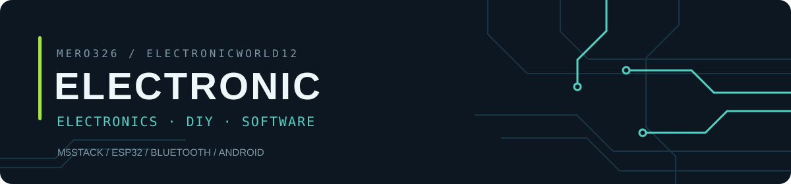

  

  <a href="https://www.tiktok.com/@electronicworld12"><b>TikTok · @electronicworld12</b></a>
  &nbsp; / &nbsp;
  <a href="https://t.me/m5stiksplus2"><b>Telegram · electronicworld12</b></a>

## Привет, я Electronic ⚡

Создаю проекты с электроникой и приложения. Экспериментирую с гаджетами, M5Stack и ESP32, делюсь результатами и инструкциями в TikTok и Telegram.

Здесь можно найти код, приложения и материалы к моим проектам.

**Электроника · DIY · M5Stack / ESP32 · Bluetooth · Android**

## Hi, I'm Electronic ⚡

I build electronics projects and apps. I experiment with gadgets, M5Stack and ESP32, and share demos and tutorials on TikTok and Telegram.

Here you'll find code, apps and supporting materials for my projects.

## Проекты / Projects

### 🖱️ M5StickC Plus2 Air Mouse

Bluetooth-мышь с управлением движением: гироскоп перемещает курсор, кнопки устройства отвечают за левый и правый клик. В репозитории — код и инструкция по настройке.

*A Bluetooth air mouse controlled by the gyroscope, with device buttons for left and right clicks. Includes source code and setup instructions.*

**M5StickC Plus2 · ESP32 · C++ / Arduino · Bluetooth LE**

[Код и инструкция / Code & setup →](https://github.com/Mero326/M5StickC-Plus2-Air-Mouse)

---

### 🌿 Пауза / Pause

Android-приложение для осознанного входа в выбранные приложения: дыхательная пауза, таймер сеанса и заметки. В репозитории — APK 1.0, презентация и скриншоты.

*An Android app that adds a breathing pause before selected apps, with session timers and notes. The repository contains the version 1.0 APK, a presentation and screenshots.*

**Android · Версия / Version 1.0 · APK ≈75 КБ / kB**

[Приложение и материалы / App & materials →](https://github.com/Mero326/Pause-Android)

---

## Видео и обновления / Videos & updates

Показываю проекты в работе и рассказываю, как они устроены.

*Project demos, tutorials and updates:*

- [TikTok — @electronicworld12](https://www.tiktok.com/@electronicworld12)
- [Telegram — electronicworld12](https://t.me/m5stiksplus2)
